<p align="center">
  <a href="assets/banner.svg">
    
  </a>
</p>

# 🔍 Awesome Enterprise Search ⚡🧠

<p align="center">
  <strong>Curated Directory of Enterprise SaaS Solutions &amp; Battle-Tested Open-Source Search Engines for Workplace Knowledge Discovery, RAG Q&amp;A, Neural Search, and Sovereign Information Retrieval.</strong>
</p>

<p align="center">
  <a href="https://github.com/ishandutta2007/Awesome-Awesome-Awesome"></a><a href="https://discord.gg/jc4xtF58Ve"></a>
  <a href="https://github.com/ishandutta2007/Awesome-Enterprise-Search/stargazers"></a>
  <a href="https://github.com/ishandutta2007/Awesome-Enterprise-Search/network/members"></a>
  <a href="LICENSE"></a>
  <a href="https://github.com/ishandutta2007/Awesome-Enterprise-Search/pulls"></a>
  <a href="https://github.com/ishandutta2007/Awesome-Enterprise-Search/graphs/contributors"></a>
  <a href="https://github.com/ishandutta2007"></a>
</p>

---

## 📑 Table of Contents

- [🌐 Sector Overview &amp; Market Dynamics](#-sector-overview--market-dynamics)
- [🏢 Enterprise SaaS &amp; Hosted Search Platforms](#-enterprise-saas--hosted-search-platforms)
  - [📊 SaaS Comparison &amp; Pricing Matrix](#-saas-comparison--pricing-matrix)
  - [🔍 Deep-Dive: Enterprise SaaS Solutions](#-deep-dive-enterprise-saas-solutions)
- [🔓 Open-Source GitHub Projects](#-open-source-github-projects)
- [🧭 Architecture &amp; Evaluation Blueprint](#-architecture--evaluation-blueprint)
- [🤝 How to Contribute](#-how-to-contribute)
- [💖 Support &amp; Sponsoring](#-support--sponsoring)
- [📈 Star History](#-star-history)
- [⚖️ Disclaimer &amp; Governance](#️-disclaimer--governance)

---

## 🌐 Sector Overview &amp; Market Dynamics

The global **Enterprise Search Market** was estimated at approximately **$5.34 billion to $6.67 billion in 2025** (averaging ~$5.8 billion) and is projected to expand to **$8.66 billion to $11.66 billion by 2030–2031**, exhibiting a steady compound annual growth rate (**CAGR of 8.4% to 9.5%**). Growth is propelled by exponential enterprise data sprawl across fragmented SaaS silos (Slack, Confluence, Google Drive, Jira, Salesforce) and the urgent transition from legacy keyword indexing to **Retrieval-Augmented Generation (RAG)**, neural re-ranking, and generative conversational answers.

From a market structure perspective, the enterprise search sector exhibits **medium concentration with moderate fragmentation**:
- **Hyperscaler Ecosystems (High Concentration / Suite Bundling):** Mega-cap cloud providers (**Microsoft 365 Copilot / SharePoint Search**, **Amazon Kendra / Q Business**, and **Google Cloud Search / Vertex AI Search**) capture vast enterprise volume by embedding baseline enterprise search directly into workplace productivity suites and cloud consumption agreements (MACC / AWS EDP).
- **Specialized AI Pure-Plays (Concentrated Mid-Market Leaders):** Dedicated cognitive search and workplace intelligence engines (**Glean, Coveo, Sinequa, Lucidworks, AlphaSense, Hebbia**) defend robust market positions by providing 100+ out-of-the-box SaaS connectors, fine-grained access control list (ACL) inheritance, multimodal PDF parsing, and domain-specialized financial and legal synthesis.
- **Self-Hosted &amp; Sovereign Long-Tail (High Fragmentation):** To avoid steep per-seat licenses ($30–$75+/user/month) and protect confidential corporate IP from third-party model scraping, organizations are aggressively deploying open-source, air-gapped infrastructure (**RAGFlow, Onyx, Meilisearch, Typesense, Qdrant, OpenSearch, Vespa**). This guarantees strict data sovereignty, GDPR/HIPAA compliance, and full control over indexing pipelines.

---

## 🏢 Enterprise SaaS &amp; Hosted Search Platforms

Enterprise SaaS search platforms provide turn-key connectors, automated document parsing, zero-trust permission synchronization, and managed generative answer engines.

### 📊 SaaS Comparison &amp; Pricing Matrix

The table below benchmarks category-leading enterprise SaaS search platforms, **sorted in descending order by parent company valuation / market capitalization**.

| 🏢 Platform / Service | 💼 Company Size (Valuation / Revenue) | 💵 Starting Tier Pricing | 🎁 Free Tier / Free Trial Limits | 🛡️ Key Enterprise Focus &amp; Capabilities |
| :--- | :--- | :--- | :--- | :--- |
| **[Microsoft 365 Copilot &amp; Search](https://www.microsoft.com/en-us/microsoft-365/enterprise-search)** | **~$3.12 Trillion** Market Cap<br>(~$245B Annual Revenue) | **$30.00 / user / month**<br>(Copilot add-on, billed annually; or included base search in M365 E3 at $36/user/mo) | **30-day free trial** for Microsoft 365 E3/E5 with up to 25 user licenses; no standalone free forever plan | Semantic search across Microsoft Graph (OneDrive, SharePoint, Teams, Exchange) with native Entra ID permission trimming. |
| **[Amazon Kendra](https://aws.amazon.com/kendra/)** | **~$2.20 Trillion** Market Cap<br>(~$620B Annual Revenue) | **$1.125 / hour (~$810.00 / month)**<br>(Developer Edition baseline index; up to 10k docs / 3 GB text &amp; 4k queries/day) | **30-day free trial** with up to 750 free hours of Developer Edition on AWS Free Tier (connectors billed separately) | Managed NLP search service with native connectors for S3, SharePoint, Salesforce, Confluence, and ServiceNow. |
| **[Google Cloud Search &amp; Vertex AI Search](https://cloud.google.com/search)** | **~$2.10 Trillion** Market Cap<br>(~$350B Annual Revenue) | **$1.50 per 1,000 queries**<br>(Vertex AI Search Standard; or bundled in Workspace Enterprise at ~$30/user/mo) | **10,000 queries/month free forever** on Vertex AI Search + **$300 GCP credit** (or 14-day Workspace Enterprise trial) | Unifies Google Workspace assets with external data; features multi-turn generative search and grounded citation extraction. |
| **[Elastic Enterprise Search](https://www.elastic.co/enterprise-search)** | **~$8.50 Billion** Market Cap<br>(~$1.35B ARR, NYSE: ESTC) | **$95.00 / month**<br>(Elastic Cloud Standard tier baseline compute &amp; storage) | **14-day free trial** on Elastic Cloud (up to 8 GB RAM &amp; 240 GB storage, no card needed); self-managed core engine is free forever | Industry-standard hybrid BM25 and vector search with learned sparse encoders (ELSER), document-level security, and custom web crawlers. |
| **[Glean](https://www.glean.com/)** | **~$4.60 Billion** Valuation<br>(~$55M+ ARR, Series E) | **~$45.00 / user / month**<br>(Typically requires 100-seat minimum, ~$54,000/year contract baseline) | **No public free tier**; 14 to 30-day guided enterprise Proof-of-Concept (POC) sandbox available upon sales qualification | Premier AI workplace assistant with 100+ native SaaS connectors, deep permission fidelity, and company-wide knowledge graphs. |
| **[AlphaSense](https://www.alpha-sense.com/)** | **~$4.00 Billion** Valuation<br>(~$200M+ ARR, backed by Alphabet) | **~$10,000 / user / year (~$833.33 / month)**<br>(Base corporate seat; median enterprise contracts average ~$17,500/year) | **7 to 14-day sales-guided trial** with access to SEC filings, earnings call transcripts, and broker research upon verification | Specialized market intelligence engine indexing regulatory filings, research libraries, and expert call archives (Tegus). |
| **[Algolia Search](https://www.algolia.com/)** | **~$2.25 Billion** Valuation<br>(~$100M+ ARR, Series D) | **$0.00 / month**<br>(Grow plan base; pay-as-you-go overages at $0.50/1k searches &amp; $0.40/1k records) | **Free Plan forever** with 10,000 search requests/month, 50,000 records, 5,000 recommendations/month, up to 10 indices | Ultra-fast developer search API with sub-20ms response times, typo tolerance, dynamic facets, and NeuralSearch AI ranking. |
| **[Sinequa](https://www.sinequa.com/)** | **~$1.10 Billion** Valuation<br>(€1B+ ChapsVision parent valuation; ~$60M ARR) | **~$40,000 / year (~$3,333.33 / month)**<br>(Enterprise tier based on indexed volume; available via Azure Marketplace MACC) | **No public free tier**; 30-day guided enterprise Proof-of-Concept (POC) and security evaluation upon sales scoping | Petabyte-scale cognitive search engine for global enterprises with complex multi-hop entitlement mapping and NLP pipelines. |
| **[Hebbia](https://www.hebbia.ai/)** | **~$700 Million** Valuation<br>(~$15M ARR, Series B led by a16z) | **~$3,000 / seat / year (~$250.00 / month)**<br>(Lite viewer tier; $10,000/seat/year for Analyst Matrix power users) | **No public free tier**; private pilot demonstrations and custom NDA evaluation sandboxes for finance &amp; legal teams | AI-native Matrix workspace that reads millions of complex documents in parallel, executing multi-step reasoning with tabular citations. |
| **[Coveo Relevance Cloud](https://www.coveo.com/)** | **~$520 Million** Market Cap<br>(~$700M CAD, ~$125M ARR, TSX: CVO) | **~$600.00 / month**<br>(Billed annually; includes base package of 100k queries/month and 100k indexed items) | **14-day free trial** with access to Relevance Cloud administration console and search UI builder (no credit card required) | AI-powered relevance platform combining keyword, dense vector, and generative answering across service desks, portals, and intranets. |
| **[Lucidworks Fusion](https://lucidworks.com/)** | **~$300 Million** Valuation<br>(~$75M ARR, backed by Francisco Partners) | **~$28,000 / year (~$2,333.33 / month)**<br>(Baseline enterprise license; contracts scale to $79,000+ based on index volume) | **No public free tier**; sales-assisted evaluation POC environment available for qualified enterprise architecture teams | Highly configurable Apache Solr-based search engine with clickstream machine learning re-ranking and custom connector pipelines. |
| **[Guru](https://www.getguru.com/)** | **~$250 Million** Valuation<br>(~$25M+ ARR, Series C) | **$15.00 / user / month**<br>(All-in-one AI Search and Knowledge Base tier billed annually) | **30-day fully featured free trial** (unlimited users &amp; queries, no credit card required); Free starter plan for up to 3 users | Slack, Teams, and browser-integrated knowledge search delivering verified single-source-of-truth answers across internal apps. |

---

### 🔍 Deep-Dive: Enterprise SaaS Solutions

- **[Microsoft 365 Copilot &amp; Search](https://www.microsoft.com/en-us/microsoft-365/enterprise-search)**  
  Integrates generative AI search across the entire Microsoft 365 suite. Indexes internal messages, emails, OneDrive documents, and SharePoint sites with strict adherence to Azure Entra ID permissions and compliance boundaries.
- **[Amazon Kendra](https://aws.amazon.com/kendra/)**  
  AWS's managed document search engine powered by machine learning. Excels in ingesting unstructured corporate documents from over 40 enterprise repositories and returning precise excerpt answers alongside document links.
- **[Google Cloud Search &amp; Vertex AI Search](https://cloud.google.com/search)**  
  Applies Google's indexing and natural language understanding to enterprise repositories. Offers out-of-the-box connectors for Google Drive, Gmail, Salesforce, and Confluence, supporting multi-turn conversational exploration.
- **[Elastic Enterprise Search](https://www.elastic.co/enterprise-search)**  
  Commercial cloud offering built atop Elasticsearch. Combines robust BM25 keyword matching with Elastic's Learned Sparse Encoder (ELSER) and dense vector representations to deliver hybrid search at massive scale.
- **[Glean](https://www.glean.com/)**  
  The category benchmark for AI workplace search. Connects to dozens of SaaS applications, creates an internal enterprise knowledge graph, and delivers grounded answers with citations while preserving source ACLs.
- **[AlphaSense](https://www.alpha-sense.com/)**  
  Domain-specialized search platform purpose-built for investment banking, private equity, and corporate strategy. Scans millions of equity research reports, company transcripts, and SEC filings.
- **[Algolia Search](https://www.algolia.com/)**  
  API-first search platform engineered for developer speed and front-end consumer experiences. Delivers sub-20ms search as you type, multi-language typo tolerance, and AI personalization.
- **[Sinequa](https://www.sinequa.com/)**  
  Enterprise cognitive search platform built for massive, complex environments such as aerospace, defense, and pharmaceutical R&amp;D. Features advanced NLP and deep security entitlement engines.
- **[Hebbia](https://www.hebbia.ai/)**  
  AI document intelligence platform utilized by financial institutions and law firms. Enables users to load thousands of pages of contracts or diligence files and extract verified data points into structured spreadsheets.
- **[Coveo](https://www.coveo.com/)**  
  Unified relevance platform delivering AI recommendations and hybrid search across customer service portals (Salesforce, Zendesk), internal intranets, and headless commerce applications.
- **[Lucidworks Fusion](https://lucidworks.com/)**  
  Enterprise search platform built on Apache Solr that grants platform engineers complete governance over query pipelines, ranking formulas, ML click re-ranking, and custom security plugins.
- **[Guru](https://www.getguru.com/)**  
  Collaborative knowledge management and AI search tool that sits directly inside employee workflows (Chrome, Slack, Microsoft Teams), surfacing verified answers without tab switching.

---

## 🔓 Open-Source GitHub Projects

The open-source enterprise search landscape enables organizations to build sovereign, air-gapped search architectures without per-query metering or SaaS license lock-in. 

*Repositories below are **sorted in descending order by GitHub_Stars**.*

---

### 1. 🌟 [RAGFlow](https://github.com/infiniflow/ragflow) [](https://github.com/infiniflow/ragflow/stargazers)
- **License:** Apache-2.0 | **Primary Language:** Python
- **Summary:** An open-source RAG engine based on deep document understanding. Extracts complex formatting, multi-column layouts, tables, and charts from unstructured enterprise PDFs and slides to construct a grounded context layer for LLMs.
- **Enterprise Capabilities:** Visual document chunking with DeepDoc OCR, hybrid BM25 + vector retrieval, multi-engine support, and verifiable citation bounding boxes.
- **Best Suited For:** Organizations needing precise RAG Q&amp;A over complex enterprise manuals, financial filings, and scanned technical documentation.

---

### 2. 🌟 [Elasticsearch](https://github.com/elastic/elasticsearch) [](https://github.com/elastic/elasticsearch/stargazers)
- **License:** Elastic License 2.0 / SSPL | **Primary Language:** Java
- **Summary:** The foundational distributed, RESTful search and analytics engine that powers thousands of enterprise search platforms worldwide.
- **Enterprise Capabilities:** Hybrid lexical + dense vector search, Reciprocal Rank Fusion (RRF), native Lucene inverted indexing, horizontal sharding, and cross-cluster replication.
- **Best Suited For:** Large engineering organizations requiring a proven, battle-tested distributed search backbone scaling to billions of documents.

---

### 3. 🌟 [Meilisearch](https://github.com/meilisearch/meilisearch) [](https://github.com/meilisearch/meilisearch/stargazers)
- **License:** MIT | **Primary Language:** Rust
- **Summary:** A lightning-fast, typo-tolerant search engine API bringing AI-powered hybrid search to customer-facing applications and corporate wikis.
- **Enterprise Capabilities:** Sub-50ms query response times, zero-configuration deployment, semantic vector search, federated search across multi-tenant indices, and geo-search.
- **Best Suited For:** Developer-centric application search, product catalogs, documentation search, and fast internal knowledge lookup.

---

### 4. 🌟 [Milvus](https://github.com/milvus-io/milvus) [](https://github.com/milvus-io/milvus/stargazers)
- **License:** Apache-2.0 | **Primary Language:** Go / C++
- **Summary:** Cloud-native, high-performance distributed vector database built specifically for massive-scale similarity search and AI applications.
- **Enterprise Capabilities:** Billion-scale approximate nearest neighbor (ANN) search, hybrid retrieval with sparse vector support, GPU acceleration, and disaggregated compute/storage architecture.
- **Best Suited For:** Massive semantic search clusters, multimodal image/text retrieval, and enterprise RAG backends handling ten-million+ embeddings.

---

### 5. 🌟 [Khoj](https://github.com/khoj-ai/khoj) [](https://github.com/khoj-ai/khoj/stargazers)
- **License:** AGPL-3.0 | **Primary Language:** Python
- **Summary:** Self-hostable AI second brain and enterprise assistant. Searches personal notes, internal documentation, PDFs, and web links with conversational agents.
- **Enterprise Capabilities:** Offline local LLM compatibility (Ollama, llama.cpp), scheduled automations, deep research workflows, and browser extensions.
- **Best Suited For:** Teams seeking a private, self-hosted workplace research assistant running entirely on local hardware.

---

### 6. 🌟 [Qdrant](https://github.com/qdrant/qdrant) [](https://github.com/qdrant/qdrant/stargazers)
- **License:** Apache-2.0 | **Primary Language:** Rust
- **Summary:** Production-grade vector database and search engine with extended filtering support, built in Rust for memory safety and raw throughput.
- **Enterprise Capabilities:** Payload-based boolean filtering during vector search, quantization (scalar &amp; binary), hybrid dense-sparse retrieval, and snapshot backups.
- **Best Suited For:** Neural search applications requiring real-time metadata filtering (e.g. tenant IDs, ACL permissions, dates) alongside vector proximity.

---

### 7. 🌟 [Onyx (formerly Danswer)](https://github.com/onyx-dot-app/onyx) [](https://github.com/onyx-dot-app/onyx/stargazers)
- **License:** MIT | **Primary Language:** Python / TypeScript
- **Summary:** The premier open-source generative AI and workplace search platform. Connects to 40+ enterprise tools (Google Drive, Slack, Confluence, GitHub, Jira, Notion) and provides a private ChatGPT-like conversational assistant.
- **Enterprise Capabilities:** Document-level access control (RBAC), hybrid BM25 + dense embedding retrieval, Slack/Teams bot integration, user query analytics, and air-gapped Docker/Kubernetes deployment.
- **Best Suited For:** Organizations looking for an immediate open-source, self-hosted alternative to Glean without per-user licensing fees.

---

### 8. 🌟 [Typesense](https://github.com/typesense/typesense) [](https://github.com/typesense/typesense/stargazers)
- **License:** GPL-3.0 | **Primary Language:** C++
- **Summary:** Open-source, in-memory alternative to Algolia and an easier-to-manage alternative to Elasticsearch for typo-tolerant, instantaneous search.
- **Enterprise Capabilities:** In-memory indexing, built-in vector search and embedding generation, typo-tolerance algorithms, automatic high availability clustering, and geo-search.
- **Best Suited For:** Applications demanding instant as-you-type search experiences with minimal operational overhead.

---

### 9. 🌟 [Weaviate](https://github.com/weaviate/weaviate) [](https://github.com/weaviate/weaviate/stargazers)
- **License:** BSD-3-Clause | **Primary Language:** Go
- **Summary:** Cloud-native, modular vector database that stores both raw objects and vector embeddings, supporting seamless vector search combined with structured filtering.
- **Enterprise Capabilities:** Native modules for HuggingFace, OpenAI, Cohere, and local models; GraphQL and REST APIs; multi-modal vector search; and horizontal scalability.
- **Best Suited For:** Developers creating complex RAG pipelines that require tight integration between embedding models, vector indices, and structured object storage.

---

### 10. 🌟 [OpenSearch](https://github.com/opensearch-project/OpenSearch) [](https://github.com/opensearch-project/OpenSearch/stargazers)
- **License:** Apache-2.0 | **Primary Language:** Java
- **Summary:** Community-driven, 100% open-source search and analytics suite forked from Elasticsearch and Kibana, backed by AWS, SAP, and Red Hat.
- **Enterprise Capabilities:** Neural search plugin, k-NN vector search, asynchronous search, fine-grained access control with OpenSearch Security, SQL/PPL querying, and index state management.
- **Best Suited For:** Enterprises committed to strict Apache-2.0 licensing looking for an unencumbered search and log analytics engine.

---

### 11. 🌟 [Quickwit](https://github.com/quickwit-oss/quickwit) [](https://github.com/quickwit-oss/quickwit/stargazers)
- **License:** AGPL-3.0 / Apache-2.0 | **Primary Language:** Rust
- **Summary:** Cloud-native search engine designed for massive-scale text search and log/trace analytics directly over object storage (Amazon S3, Google Cloud Storage, MinIO).
- **Enterprise Capabilities:** Sub-second queries directly on object storage without local disk indexing, stateless searcher instances, sub-linear indexing costs, and Tantivy engine core.
- **Best Suited For:** High-volume enterprise audit log search, compliance archiving, and cost-effective multi-terabyte search workloads.

---

### 12. 🌟 [Vespa](https://github.com/vespa-engine/vespa) [](https://github.com/vespa-engine/vespa/stargazers)
- **License:** Apache-2.0 | **Primary Language:** C++ / Java
- **Summary:** The battle-tested AI search and recommendation engine developed by Yahoo, powering large-scale, low-latency evaluation of ML models over billions of documents.
- **Enterprise Capabilities:** Native multi-phase ranking with neural networks, real-time index writes with immediate read visibility, hybrid search, and tensor computation at query time.
- **Best Suited For:** High-throughput enterprise production systems requiring sophisticated multi-phase re-ranking and real-time machine learning inference.

---

### 13. 🌟 [Infinity](https://github.com/infiniflow/infinity) [](https://github.com/infiniflow/infinity/stargazers)
- **License:** Apache-2.0 | **Primary Language:** C++
- **Summary:** AI-native database engineered for LLM applications, providing ultra-fast hybrid search across dense vectors, sparse vectors, multi-vector tensors (ColBERT), and full-text BM25.
- **Enterprise Capabilities:** Sub-millisecond hybrid retrieval, zero-copy memory architecture, disk-backed HNSW indexing, and unified query planner.
- **Best Suited For:** High-performance RAG context retrieval engines requiring state-of-the-art ColBERT token-level tensor matching.

---

### 14. 🌟 [Apache Lucene](https://github.com/apache/lucene) [](https://github.com/apache/lucene/stargazers)
- **License:** Apache-2.0 | **Primary Language:** Java
- **Summary:** The foundational Java library that serves as the gold standard for full-text indexing and retrieval algorithms worldwide (powering Solr, Elasticsearch, and OpenSearch).
- **Enterprise Capabilities:** Inverted index architecture, BM25 scoring, HNSW vector search support, custom tokenizers, and spatial/faceted indexing.
- **Best Suited For:** Software architects and core search engineers building custom search libraries and bespoke index storage engines.

---

### 15. 🌟 [Gerev AI](https://github.com/GerevAI/gerev) [](https://github.com/GerevAI/gerev/stargazers)
- **License:** MIT | **Primary Language:** Python
- **Summary:** Open-source AI-powered enterprise search engine designed for workplace knowledge discovery. Indexes internal communication and wikis to surface direct answers.
- **Enterprise Capabilities:** Confluence, Slack, Google Drive, and Jira connectors; vector indexing; and conversational UI.
- **Best Suited For:** Reference deployments and teams exploring lightweight self-hosted internal search prototypes.

---

### 16. 🌟 [SeekStorm](https://github.com/SeekStorm/SeekStorm) [](https://github.com/SeekStorm/SeekStorm/stargazers)
- **License:** Apache-2.0 | **Primary Language:** Rust
- **Summary:** Sub-millisecond vector and full-text lexical search library and multi-tenancy standalone server written in Rust.
- **Enterprise Capabilities:** In-process embedded library or standalone HTTP server, ultra-low RAM footprint, real-time index mutation, and sub-millisecond execution.
- **Best Suited For:** Latency-critical edge search workloads and high-concurrency microservices requiring extreme resource efficiency.

---

### 17. 🌟 [Apache Solr](https://github.com/apache/solr) [](https://github.com/apache/solr/stargazers)
- **License:** Apache-2.0 | **Primary Language:** Java
- **Summary:** Mature, highly reliable enterprise search server built on Apache Lucene, providing distributed indexing, advanced schema definitions, and XML/JSON APIs.
- **Enterprise Capabilities:** SolrCloud distributed architecture, ZooKeeper cluster coordination, complex faceted navigation, spatial search, and rich document parsing (Apache Tika).
- **Best Suited For:** Legacy enterprise IT architectures, digital libraries, and e-commerce catalogs requiring deep query customization and proven clustering stability.

---

### 18. 🌟 [Fess](https://github.com/codelibs/fess) [](https://github.com/codelibs/fess/stargazers)
- **License:** Apache-2.0 | **Primary Language:** Java
- **Summary:** Easily deployable, full-featured enterprise search server built on top of OpenSearch/Elasticsearch with extensive out-of-the-box crawlers.
- **Enterprise Capabilities:** Web, file system, and database crawlers; Active Directory and LDAP role-based search filtering; support for 20+ languages; and document parsing.
- **Best Suited For:** Traditional on-premises enterprise environments requiring automated crawling of local file shares, intranet portals, and relational databases.

---

### 19. 🌟 [Coco AI (Infinilabs)](https://github.com/infinilabs/coco-app) [](https://github.com/infinilabs/coco-app/stargazers)
- **License:** MIT | **Primary Language:** Go / TypeScript
- **Summary:** Integrated enterprise search, connection, and personal AI assistant workspace designed by the Infinilabs engineering team.
- **Enterprise Capabilities:** Unified multi-source search interface, local desktop integration, and integrated AI assistant chat.
- **Best Suited For:** Teams seeking an all-in-one personal and team knowledge discovery assistant.

---

### 20. 🌟 [Turing ES (Viglet)](https://github.com/openviglet/turing-ce) [](https://github.com/openviglet/turing-ce/stargazers)
- **License:** Apache-2.0 | **Primary Language:** Java
- **Summary:** Open-source enterprise search and generative AI platform featuring faceted semantic search, hybrid BM25 + vector ranking with Reciprocal Rank Fusion, and RAG chat with inline citations.
- **Enterprise Capabilities:** Multi-engine abstraction (Apache Solr, Elasticsearch, embedded Lucene), Viglet Dumont connectors for Adobe AEM and WordPress, MCP tool agents, and air-gapped readiness.
- **Best Suited For:** Enterprise CMS and portal deployments (Adobe Experience Manager, WordPress) requiring turnkey semantic search and inline generative citations.

---

## 🧭 Architecture &amp; Evaluation Blueprint

Selecting the right enterprise search architecture requires balancing **connector breadth**, **permission governance**, **query latency**, and **data residency**:

```
+---------------------------------------------------------------------------------------------------+
|                              ENTERPRISE SEARCH ARCHITECTURAL MATRIX                               |
+--------------------------+-------------------------------------+----------------------------------+
| Architectural Dimension  | Commercial Enterprise SaaS          | Self-Hosted Open-Source          |
+--------------------------+-------------------------------------+----------------------------------+
| Data Residency & Privacy | Hosted in vendor cloud (SOC2/GDPR)  | 100% On-Premises or Private Colo |
| Permission Fidelity      | Native ACL mapping (Entra/Okta/IAM) | Custom connector mapping required|
| Setup & Time-to-Value    | 2 to 6 weeks turnkey rollout        | 2 to 6 months engineering effort |
| Query / Index Scaling    | Billed per seat or query volume     | Billed on compute/RAM hardware   |
| RAG Grounding            | Pre-tuned LLM citation engines      | Custom RAGFlow / Onyx pipelines  |
| Custom Ranking Models    | Black-box / Guided relevance tuning | Full control over BM25/Vector RRF|
+--------------------------+-------------------------------------+----------------------------------+
```

### 🎯 Key Evaluation Pillars
1. **Access Control &amp; Entitlement Inheritance**: Workplace search must enforce strict document-level permissions. If an employee cannot access a file in Google Drive or SharePoint, search snippets and LLM answers must never leak that content.
2. **Hybrid Lexical + Dense Vector Retrieval**: Pure vector search degrades on exact part numbers, code snippets, acronyms, and names. State-of-the-art systems combine BM25 sparse matching with dense embeddings using **Reciprocal Rank Fusion (RRF)**.
3. **Citation Grounding &amp; Hallucination Prevention**: For regulated enterprises, search must provide verifiable, pixel-exact references and inline link citations rather than unchecked model generation.

---

## 🤝 How to Contribute

Contributions from search engineers, data architects, and open-source enthusiasts are warmly encouraged! 🚀

1. 🍴 **Fork the Repository**: Click the Fork button at the top right of this page.
2. 🌿 **Create a Feature Branch**: `git checkout -b feature/add-new-search-engine`
3. 📝 **Add or Update Entries in `README.md`**:
   - For **SaaS platforms**: Include platform name, official URL, company scale (valuation/revenue), specific starting tier pricing, and exact free tier/trial limits.
   - For **Open-Source projects**: Include repository URL, social Stars_Badge (`style=social&color=white`) linking to `/stargazers`, license, and concise technical summary. Ensure repositories remain sorted descending by Stars_Count.
4. ✅ **Ensure Consistent Formatting, Markdown Standards, and Working Links**.
5. 🚀 **Submit a Pull Request**: Provide a clear explanation of the addition and relevant source citations.

⭐ **Star this repository** if it helped you evaluate the enterprise search ecosystem!

---

## 💖 Support &amp; Sponsoring

Thank you for exploring and utilizing **Awesome-Enterprise-Search**! 🚀

If this curated directory helps you or your organization design, evaluate, or deploy enterprise search and retrieval infrastructure, please consider supporting the project:

- ⭐ **Star this repository** to improve visibility and help other architects discover it.
- 🍴 **Fork the repo** to benchmark your own custom connectors and search engines.
- 📢 **Share with colleagues** across AI engineering, DevOps, and IT communities on LinkedIn, X/Twitter, and Discord.
- ☕ **Buy me a coffee / Sponsor the project**: Support continuous research and ecosystem maintenance via the [GitHub Sponsors Dashboard](https://github.com/sponsors/ishandutta2007) 💖

<p align="left">
  <a href="https://github.com/sponsors/ishandutta2007">
    
  </a>
</p>

---

## 📈 Star History

[](https://star-history.dera.page/#ishandutta2007/Awesome-Enterprise-Search&type=date&legend=top-left)

---

## ⚖️ Disclaimer &amp; Governance

- This repository is a **community-curated directory** created for educational, architectural, and benchmarking purposes. Mention of commercial vendors or open-source projects does not imply official endorsement or sponsorship.
- Pricing, free trial terms, and corporate valuations change frequently. Always verify current commercial quotes directly with official vendor documentation before procurement.
- Self-hosted enterprise search systems require regular index maintenance, secure connector credential rotation, automated snapshot backups, and continuous access control audits.

---

<p align="center">
  <b>Built with ❤️ for search engineers, enterprise architects, DevOps leaders, and data sovereignty champions worldwide.</b>
</p>
